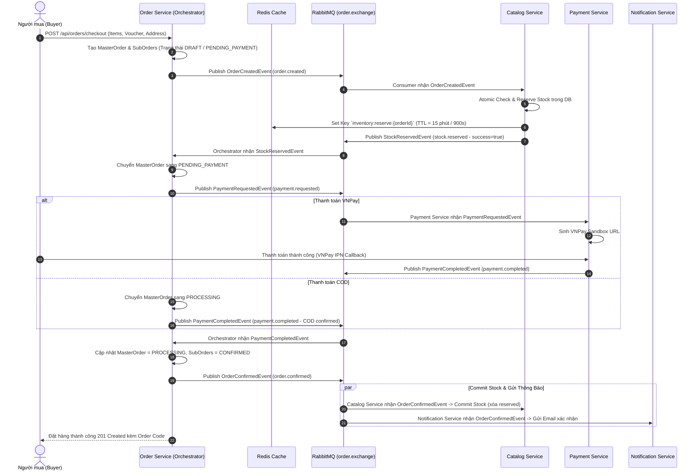
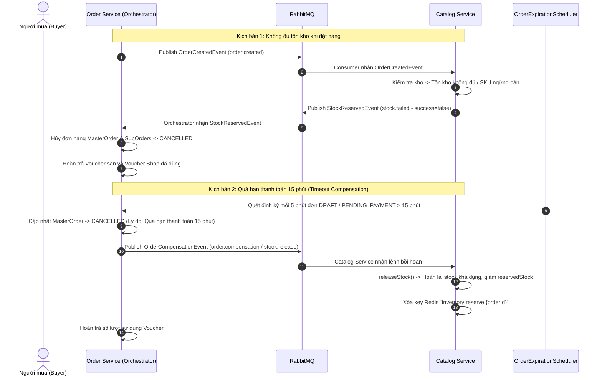
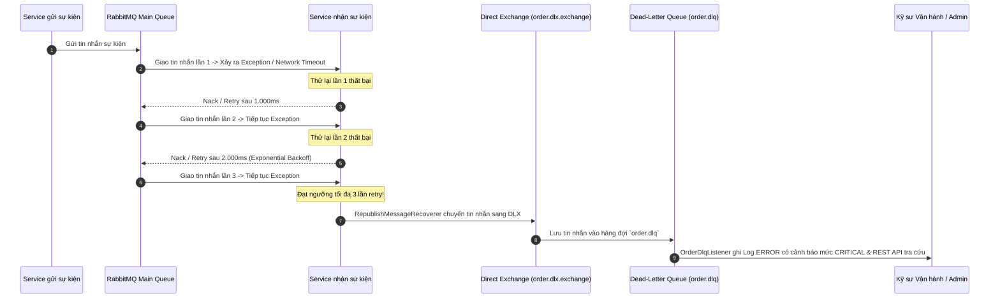

# KIẾN TRÚC SAGA CHECKOUT ORCHESTRATOR & EVENT CONTRACTS

> **Tài liệu đặc tả kiến trúc điều phối giao dịch phân tán (Saga Pattern)**  
> **Phân hệ:** Order, Catalog, Payment, Notification  
> **Người thiết kế:** Nguyễn Văn Kiên  
> **Ngày phê duyệt:** 07/11/2026 - 09/11/2026  
> **Phiên bản:** 1.0.0

---

## 1. Tổng quan Kiến trúc Saga Orchestration

Trong hệ thống E-Commerce QuickShop với kiến trúc Microservices và mô hình **Database-per-Service**, một giao dịch đặt mua hàng (Checkout Flow) trải dài qua nhiều dịch vụ độc lập:
- **Order Service:** Đóng vai trò **Saga Orchestrator** điều phối toàn bộ vòng đời đơn hàng, quản lý trạng thái Master/Sub-Orders và Voucher.
- **Catalog Service:** Quản lý kho hàng, giữ tồn kho (Reserve Stock có TTL 15 phút), giải phóng tồn kho (Release Stock khi hủy) và trừ kho vĩnh viễn (Commit Stock khi thanh toán thành công).
- **Payment Service:** Xử lý thanh toán trực tuyến qua cổng VNPay Sandbox hoặc đối soát đơn COD, quản lý Tài khoản Tạm giữ (Escrow) và Ví Seller.
- **Notification Service:** Lắng nghe các sự kiện đơn hàng qua RabbitMQ để gửi email OTP/xác nhận và thông báo đẩy.

Giao tiếp giữa các services được thực hiện bất đồng bộ (Asynchronous Messaging) thông qua **RabbitMQ Topic Exchange** kèm cơ chế **Dead-Letter Queue (DLQ)** để xử lý các sự cố nghiêm trọng sau tối đa 3 lần retry.

---

## 2. Mermaid Sequence Diagrams

### 2.1 Luồng Đặt hàng Thành công (Happy Path)

---

### 2.2 Luồng Thất bại & Giao dịch Bồi hoàn (Failure & Compensation Flow)

---

### 2.3 Luồng Retry 3 Lần & Dead-Letter Queue (`order.dlq`)

---

## 3. Ma trận Hợp đồng Sự kiện (Event Contracts Matrix)

| Tên Event Class | Exchange | Routing Key | Dịch vụ Phát | Dịch vụ Nhận | Mục đích nghiệp vụ |
| :--- | :--- | :--- | :--- | :--- | :--- |
| `OrderCreatedEvent` | `order.exchange` | `order.created` | Order Service | Catalog Service | Kích hoạt giữ tồn kho (Reserve Stock) cho danh sách SKU |
| `StockReservedEvent` | `catalog.exchange` | `stock.reserved` | Catalog Service | Order Service | Báo kết quả giữ kho thành công (`success=true`) |
| `StockReservedEvent` | `catalog.exchange` | `stock.failed` | Catalog Service | Order Service | Báo giữ kho thất bại (`success=false`), kèm lý do chi tiết |
| `PaymentRequestedEvent`| `order.exchange` | `payment.requested` | Order Service | Payment Service | Yêu cầu chuẩn bị thanh toán VNPay hoặc đối soát COD |
| `PaymentCompletedEvent`| `order.exchange` | `payment.completed` | Payment Service | Order Service | Báo nhận tiền thành công từ cổng VNPay / xác nhận COD |
| `PaymentFailedEvent` | `order.exchange` | `payment.failed` | Payment Service | Order Service | Báo lỗi giao dịch thanh toán để kích hoạt bồi hoàn hủy đơn |
| `OrderConfirmedEvent` | `order.exchange` | `order.confirmed` | Order Service | Catalog, Notification | Xác nhận đơn hoàn tất; Catalog trừ kho vĩnh viễn, gửi email |
| `OrderCompensationEvent` / `StockReleaseEvent` | `order.exchange` | `stock.release` | Order Service | Catalog Service | Lệnh bồi hoàn giải phóng tồn kho (Release Stock) |
| `OrderDlqMessage` | `order.dlx.exchange` | `order.dlq.routing` | RabbitMQ Recoverer | Order Service (DLQ Listener) | Lưu trữ và giám sát các sự kiện xử lý thất bại sau 3 lần retry |

---

## 4. Ma trận Trạng thái Đơn hàng (State Machine Transitions)

| Trạng thái Hiện tại | Sự kiện Kích hoạt | Trạng thái Kế tiếp | Hành động Kèm theo |
| :--- | :--- | :--- | :--- |
| `(Khởi tạo)` | Buyer Checkout giỏ hàng | `DRAFT` | Tạo đơn hàng, snapshot SKU/giá, phát `order.created` |
| `DRAFT` | `stock.reserved` (COD) | `PROCESSING` | Giữ kho thành công, đơn COD chuyển thẳng sang xử lý |
| `DRAFT` | `stock.reserved` (Online VNPay) | `PENDING_PAYMENT` | Giữ kho thành công, tạo yêu cầu thanh toán (TTL 15 phút) |
| `DRAFT` | `stock.failed` | `CANCELLED` | Kho hết hàng, hủy đơn ngay lập tức, hoàn lại voucher |
| `PENDING_PAYMENT` | `payment.completed` | `PROCESSING` | Khách thanh toán VNPay thành công, chuyển xử lý đơn |
| `PENDING_PAYMENT` | `payment.failed` / Timeout 15m | `CANCELLED` | Quá hạn 15 phút, phát lệnh nhả kho (`stock.release`), hủy đơn |
| `PROCESSING` | Shop xác nhận đơn | `CONFIRMED` | Gửi lệnh trừ kho vĩnh viễn (commit reserved stock) |
| `CONFIRMED` | Shop đóng gói xong | `PACKING` | Chuẩn bị hàng giao cho đơn vị vận chuyển |
| `PACKING` | Bàn giao hãng vận chuyển | `SHIPPING` | Tạo vận đơn và mã tracking GHN/GHTK |
| `SHIPPING` | Giao thành công | `DELIVERED` | Buyer nhận hàng, kích hoạt đếm ngược 3 ngày Escrow |
| `DELIVERED` | Quá 3 ngày không khiếu nại | `COMPLETED` | Giải phóng tiền Escrow vào ví khả dụng của Seller |
